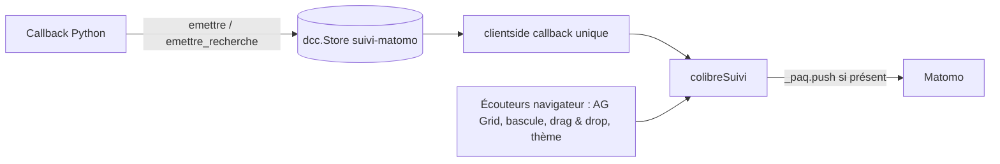

# Suivi Matomo des actions utilisateurs (#149)

Date : 2026-10-09

## Objectif

Mieux comprendre l'usage de colibre pour améliorer le produit : quelles
fonctions servent, dans quel ordre, avec quels filtres. Chaque action listée par
l'issue #149 doit apparaître **une fois par geste réel** dans Matomo, rattachée
à la visite du navigateur qui l'a faite.

## Décisions de cadrage

| Sujet          | Décision                                                                                               | Motif                                                                                                                                                                                                                                                                                          |
| -------------- | ------------------------------------------------------------------------------------------------------ | ---------------------------------------------------------------------------------------------------------------------------------------------------------------------------------------------------------------------------------------------------------------------------------------------- |
| Identification | Parcours **anonyme** : identifiant visiteur Matomo (`_id`, cookie `_pk_id.14.*`), **aucun id Colibre** | `setUserId` sort de l'exemption de consentement CNIL ([FAQ Matomo](https://matomo.org/faq/general/configure-privacy-settings-in-matomo)) et contredirait les mentions légales (« impossible d'associer vos visites sur ce site à votre personne », `src/pages/projet/mentions_legales.py:137`) |
| Filtres        | Un Event par **jeu de filtres appliqué**, la combinaison complète sérialisée en nom                    | Choix de Colin : lire les combinaisons exactes                                                                                                                                                                                                                                                 |
| Émission       | **Le serveur décide, le navigateur envoie**                                                            | Tout arrive dans la visite du navigateur ; seul le navigateur sait distinguer une action de l'utilisateur d'une restauration programmatique                                                                                                                                                    |

Le journal des visites et le profil visiteur restent désactivés sur le site 14
(étape du guide d'exemption CNIL de Matomo). Le parcours se lit donc de façon
agrégée — segments par événement, rapport Transitions — et non visite par visite.

## Contexte : l'existant au 2026-10-09

Diagnostic mené par l'API Matomo (lecture seule) et les journaux nginx de
production :

- Du 2026-07-27 au 2026-07-31, la règle « Python » du plugin Bot Tracker
  (aujourd'hui inactive) a intercepté 2 762 envois serveur
  (`BotTracker.getBotTrackerReport`, site 14).
- Depuis la mise en production du 2026-07-31, `MATOMO_URL` valait
  `https://analytics.maudry.com` sans `/matomo.php` : `_envoyer`
  (`src/utils/tracking.py:42`) postait sur la racine, qui répond 302, sans
  erreur ni trace. Corrigé dans le `.env` de production le 2026-10-09.
- `track_download` (ajouté le 2026-08-17) n'a donc jamais rien enregistré.

Ces pannes sont closes par la correction du `.env` ; le code d'envoi serveur
n'est pas modifié par ce chantier. Restent des défauts que ce chantier règle :

- une recherche en page d'accueil est envoyée **deux fois** : `search_org` est
  appelé pour les acheteurs puis les titulaires (`src/pages/recherche.py:347`),
  et chaque appel déclenche `track_search` (`src/utils/search.py:23-24`) ;
- les filtres de `/tableau` et des fiches sont envoyés à chaque premier bloc de
  `getRowsRequest`, donc aussi au rechargement (filtre restauré du
  localStorage), sur un simple tri, et à l'application d'une vue partagée ;
- les filtres de `/observatoire`, le thème, la bascule de mode, les
  réinitialisations, le mode d'emploi et le déplacement des tuiles ne sont pas
  suivis ;
- les téléchargements ne portent ni format ni nombre de lignes ; l'export filtré
  des fiches acheteur/titulaire n'est pas suivi ;
- les envois serveur n'ont pas d'identifiant visiteur : Matomo les range dans
  une visite séparée.

## Architecture



### `src/assets/suivi.js` (nouveau)

Asset chargé automatiquement par Dash, sur le modèle de `src/assets/goals.js`.
Il expose `window.colibreSuivi` :

- `evenement(categorie, action, nom, valeur)` → `_paq.push(['trackEvent', …])`,
  arguments `nom`/`valeur` omis quand ils sont nuls ;
- `recherche(motCle, categorie, nbResultats)` →
  `_paq.push(['trackSiteSearch', …])` ;
- `serialiserFiltres(filterModel)` → chaîne canonique d'un `filterModel` AG
  Grid (voir « Sérialisation »).

L'écouteur AG Grid des filtres vit, lui, dans le namespace
`window.dashAgGridFunctions` (`src/assets/dashAgGridFunctions.js`), où Dash AG
Grid résout les chaînes de `eventListeners`, comme l'actuel
`hideShareOnUserAction` : voir « Filtres des grilles ».

Chaque fonction d'envoi ne fait rien si `window._paq` est absent : traqueur
désactivé (`tracking_enabled()`, donc développement et tests), ou bloqué par
l'internaute.

### Store global `suivi-matomo` et relais

`dcc.Store(id="suivi-matomo")` rejoint `csrf-token` et `theme-enregistre` dans
`app.layout` (`src/app.py:577-589`). Un seul `app.clientside_callback`, déclenché
par sa `data`, relaie le contenu à `colibreSuivi.evenement` ou
`colibreSuivi.recherche` selon le champ `type`.

Chaque écriture porte un `nonce` (`uuid4().hex`) : deux événements identiques
successifs modifient quand même la `data`, donc déclenchent deux envois.

Forme de la `data` :

```json
{"type": "evenement", "categorie": "Tableau", "action": "telechargement",
 "nom": "xlsx", "valeur": 1234, "nonce": "…"}
{"type": "recherche", "mot_cle": "rennes", "categorie": "accueil",
 "nb_resultats": 12, "nonce": "…"}
```

### `src/utils/suivi.py` (nouveau)

- `emettre(categorie, action, nom=None, valeur=None)` et
  `emettre_recherche(mot_cle, categorie, nb_resultats)` écrivent dans le store
  via `dash.set_props("suivi-matomo", {"data": …})`. Ils écrivent **toujours** :
  la seule garde est côté navigateur (`window._paq`). Une garde
  `tracking_enabled()` ici rendrait le chemin intestable de bout en bout, la
  suite de tests tournant sous `DEVELOPMENT=true`.
- `serialiser_filtres_observatoire(filter_params)` : sérialisation canonique du
  dictionnaire de filtres de l'observatoire, et nombre de filtres non vides.

Un callback n'émet qu'un événement : `set_props` sur la même propriété
remplace la valeur précédente de la réponse.

## Catalogue des événements

Convention : **catégorie** = page, **action** = geste, **nom** = détail,
**valeur** = nombre.

| Geste                                           | Catégorie                                                                          | Action                  | Nom                                                                                                                                                                      | Valeur                           | Émis depuis                                                                                                 |
| ----------------------------------------------- | ---------------------------------------------------------------------------------- | ----------------------- | ------------------------------------------------------------------------------------------------------------------------------------------------------------------------ | -------------------------------- | ----------------------------------------------------------------------------------------------------------- |
| Recherche en page d'accueil                     | Site search, catégorie `accueil`                                                   | —                       | texte saisi, après `strip()` ; toute recherche non vide (le seuil actuel de 4 caractères de `track_search` disparaît : « EDF » ou « ONF » sont des recherches légitimes) | résultats acheteurs + titulaires | `update_search_results` (`src/pages/recherche.py:334`) via `emettre_recherche`, une fois par recherche      |
| Filtres appliqués                               | `Tableau`, `Acheteur`, `Titulaire`                                                 | `filtres`               | jeu sérialisé                                                                                                                                                            | nombre de colonnes filtrées      | navigateur, `dashAgGridFunctions.suivreFiltres`                                                             |
| Filtres de l'observatoire                       | `Observatoire`                                                                     | `filtres`               | jeu sérialisé                                                                                                                                                            | nombre de filtres non vides      | `update_dashboard_cards` (`src/pages/observatoire.py:588`)                                                  |
| Téléchargement                                  | page (`Tableau`, `Observatoire`, `Acheteur`, `Titulaire`)                          | `telechargement`        | `xlsx`, `csv` ou `csv-datagouv`                                                                                                                                          | nombre de lignes                 | callbacks d'export, voir ci-dessous                                                                         |
| Téléchargement de la grille filtrée d'une fiche | `Acheteur`, `Titulaire`                                                            | `telechargement_filtre` | `xlsx` ou `csv`                                                                                                                                                          | nombre de lignes                 | `_download_filtered` (`src/utils/entity_grid.py:246`)                                                       |
| Réinitialisation                                | `Tableau`, `Acheteur`, `Titulaire`                                                 | `reinitialisation`      | —                                                                                                                                                                        | —                                | `reset_view` (`src/pages/tableau.py:834`), `_reset` (`src/utils/entity_grid.py:225`)                        |
| Ouverture du mode d'emploi                      | `Tableau`                                                                          | `mode_emploi`           | —                                                                                                                                                                        | —                                | `toggle_tableau_help` (`src/pages/tableau.py:737`), uniquement si `ctx.triggered_id == "tableau_help_open"` |
| Bascule de mode                                 | `Tableau`                                                                          | `mode`                  | `observatoire` ou `lignes`                                                                                                                                               | —                                | navigateur, clientside callback de persistance (`src/pages/tableau.py:1295-1304`)                           |
| Thème                                           | `Interface`                                                                        | `theme`                 | `sombre` ou `clair`                                                                                                                                                      | —                                | navigateur, clientside callback de rechargement (`src/app.py:723-734`)                                      |
| Déplacement d'une tuile                         | `Tableau` si le store cible est `tableau-card-order-nouveau`, sinon `Observatoire` | `tuile_deplacee`        | id de la tuile déplacée                                                                                                                                                  | nouvelle position (base 1)       | navigateur, gestionnaire `drop` de `src/assets/observatoire-dragdrop.js:115-129`                            |

### Filtres des grilles (`Tableau`, `Acheteur`, `Titulaire`)

`dagfuncs.suivreFiltres(params, categorie)`, ajouté à
`src/assets/dashAgGridFunctions.js`, est branché sur l'événement AG Grid
`filterChanged`. Il appelle `window.colibreSuivi` au moment de l'envoi, donc
indépendamment de l'ordre de chargement des assets :

- de `/tableau`, à côté de `hideShareOnUserAction` dans
  `_SHARE_DRIFT_LISTENERS` (`src/pages/tableau.py:107-110`) ;
- des fiches, via un nouvel argument `event_listeners` passé par
  `build_entity_grid` (`src/utils/entity_grid.py:117-130`) à `ag_grid`
  (`src/figures.py:1373`, paramètre déjà existant).

Règles :

- **seulement les actions de l'utilisateur** : les sources de
  `SHARE_PROGRAMMATIC_SOURCES` (`src/assets/dashAgGridFunctions.js:10-16`) sont
  ignorées — restauration du localStorage, vue partagée `?vue=`, filtre
  d'organisme `?acheteur_id=` / `?titulaire_id=`, réinitialisation. Les deux
  écouteurs (`hideShareOnUserAction` et `suivreFiltres`) partagent cette liste,
  qui reste définie une seule fois dans ce fichier ;
- **anti-rebond de 3 s par grille** : la saisie dans un filtre flottant
  produit un `filterChanged` par frappe ; seul l'état stable est envoyé ;
- **état lu au moment de l'envoi** : `params.api.getFilterModel()` ;
- **jeu vide non envoyé** : le retrait de tous les filtres n'est pas une
  application de filtres (la réinitialisation a son propre événement).

### Filtres de l'observatoire

`update_dashboard_cards` émet seulement si `ctx.triggered_id` est l'un des
composants de `FILTER_PARAMS` (`src/pages/observatoire.py:431`) : ni au
chargement initial (aucun déclencheur), ni sur un changement d'ordre des
tuiles (`observatoire-card-order`). Jeu vide non envoyé.

Limite assumée : un lien partagé appliqué par `restore_filters`
(`src/pages/observatoire.py:459`) modifie les mêmes composants et sera compté
comme une application de filtres.

### Téléchargements

| Export                                                            | Callback                                                                                                                   | Nom                                          | Valeur           |
| ----------------------------------------------------------------- | -------------------------------------------------------------------------------------------------------------------------- | -------------------------------------------- | ---------------- |
| `/tableau` filtré                                                 | `download_data` (`src/pages/tableau.py:698`)                                                                               | `xlsx`/`csv`                                 | `df.height`      |
| `/tableau` sans filtre (lien vers le CSV complet de data.gouv.fr) | `download_data`, branche `not filter_model` : émet avant de rendre `no_update` ; nouvelle `State("tableau-total", "data")` | `csv-datagouv`                               | total affiché    |
| `/observatoire`                                                   | `download_observatoire` (`src/pages/observatoire.py:686`)                                                                  | `xlsx`/`csv`                                 | `dff.height`     |
| fiche acheteur complète                                           | `download_acheteur_data` (`src/pages/acheteur.py:457`)                                                                     | `xlsx`/`csv`                                 | lignes exportées |
| fiche titulaire complète                                          | `download_titulaire_data` (`src/pages/titulaire.py:494`)                                                                   | `xlsx`/`csv`                                 | lignes exportées |
| grille filtrée d'une fiche                                        | `_download_filtered` (`src/utils/entity_grid.py:246`)                                                                      | `xlsx`/`csv`, action `telechargement_filtre` | `df.height`      |

Le format suit la règle existante : CSV au-delà de `EXCEL_MAX_ROWS`.

### Bascule de mode

Le clientside callback de persistance reçoit en plus
`State("tableau-mode-observatoire-persiste", "data")`. Il n'émet que si
`value !== (stocke === true)` : la restauration au chargement
(`src/pages/tableau.py:1279-1292`) écrit la valeur déjà stockée et ne compte
donc pas, y compris au premier passage où le store est vide (`false`).

### Thème

L'événement part du clientside callback qui recharge la page
(`src/app.py:723-734`), juste avant `window.location.reload()`, avec le thème
confirmé par le serveur. Passer par le store laisserait l'ordre des deux
clientside callbacks au hasard ; ici l'ordre est garanti, et Matomo envoie par
défaut via `sendBeacon` (`configAlwaysUseSendBeacon = true`, `js/piwik.js`),
qui survit au rechargement.

## Sérialisation des jeux de filtres

Même convention pour les deux sérialiseurs (`filterModel` AG Grid en JS, dict de
l'observatoire en Python) — deux formats d'entrée, pas deux copies d'une même
logique :

- une partie par colonne, colonnes triées par identifiant, séparées par `|` ;
- partie = `<colonne> <opérateur> <valeur>` ; texte entre guillemets,
  ensembles entre crochets, valeurs triées : `objet contient "voirie"`,
  `montant > 10000`, `acheteur_departement_code [35, 44]` ;
- conditions combinées AG Grid : `(<cond1> ET <cond2>)` / `(… OU …)` ;
- opérateurs AG Grid traduits : `contains` → `contient`, `notContains` →
  `ne contient pas`, `equals` → `=`, `notEqual` → `≠`, `startsWith` →
  `commence par`, `endsWith` → `finit par`, `lessThan` → `<`,
  `lessThanOrEqual` → `≤`, `greaterThan` → `>`, `greaterThanOrEqual` → `≥`,
  `inRange` → `entre … et …`, `blank` → `vide`, `notBlank` → `non vide` ;
  type inconnu : identifiant AG Grid tel quel ;
- observatoire : valeurs vides (`None`, `""`, `[]`) ignorées ; listes en
  ensembles, booléens tels quels ;
- chaîne tronquée à 500 caractères, terminée par `…`.

Même jeu de filtres → même chaîne → une seule ligne dans les rapports Matomo.

## Nettoyage

Le nouveau suivi remplace les envois serveur de recherches, filtres et
téléchargements.

**Supprimé :**

- `track_search` (`src/utils/tracking.py:63`) et ses appels :
  `src/pages/tableau.py:641`, `:713`, `:1196` ; `src/utils/entity_grid.py:160`,
  `:260` ; `src/utils/search.py:24` ; `src/utils/table.py:560`
  (`prepare_table_data`) ;
- `track_download` (`src/utils/tracking.py:79`) et ses appels :
  `src/pages/tableau.py:728`, `src/pages/observatoire.py:701`,
  `src/pages/acheteur.py:481`, `src/pages/titulaire.py:518` ;
- le paramètre `track` de `search_org` (`src/utils/search.py:8`) ; l'appel
  `track=False` de `src/mcp/queries.py:184` est simplifié ;
- le commentaire de `_envoyer` qui cite `track_search` comme appelant
  synchrone (`src/utils/tracking.py:39-41`) est réécrit ;
- les tests qui figeaient ces appels : `tests/test_grid.py:117-124`,
  `tests/test_table.py:35` et `:160`, `tests/mcp/test_queries.py:14-29`,
  `tests/test_tracking.py:93-119`.

**Conservé :** `track_mcp_tool`, `track_subscription_goal`,
`enqueue_matomo_event` (`src/api/tracking.py`) — appels MCP, webhook Frisbii et
API n'ont pas de navigateur — ainsi que `_envoyer`, `_envoyer_async` et
`_horodatage` qui les servent.

`prepare_table_data` (`src/utils/table.py:532`) n'a plus d'appelant en
production ; seule sa ligne `track_search` est retirée, la fonction reste hors
périmètre.

## Mentions légales

**Relecture préalable obligatoire** : le fichier n'est modifié qu'après
validation par Colin du texte exact ci-dessous.

Texte actuel (`src/pages/projet/mentions_legales.py:139-142`) :

```markdown
Les données suivantes sont également enregistrées, de manière anonyme, afin de mieux comprendre comment vous utilisez le site et l'améliorer :

- recherches sur la page d'accueil
- filtres appliqués aux données
```

Texte proposé :

```markdown
Les données suivantes sont également enregistrées, de manière anonyme, afin de mieux comprendre comment vous utilisez le site et l'améliorer :

- recherches sur la page d'accueil et nombre de résultats
- combinaisons de filtres appliquées aux données
- téléchargements de données (format et nombre de lignes)
- changements de thème (clair ou sombre) et de mode d'affichage du tableau (lignes ou observatoire)
- réinitialisations des filtres et ouvertures du mode d'emploi
- réorganisation des tuiles de l'observatoire
```

Le paragraphe sur l'impossibilité d'associer les visites à une personne reste
exact (aucun id Colibre envoyé) et n'est pas modifié.

Le `CHANGELOG.md` n'est pas modifié par ce chantier : Colin le rédige.

## Tests

**pytest**, sur des comportements visibles d'un utilisateur ou de Matomo :

- `serialiser_filtres_observatoire` : même jeu dans un autre ordre → même
  chaîne ; valeurs vides ignorées ; troncature à 500 caractères ; valeur =
  nombre de filtres non vides ;
- téléchargements : pour chacun des cinq callbacks d'export, l'événement porte
  le format attendu de part et d'autre de `EXCEL_MAX_ROWS` et le nombre de
  lignes du fichier produit ; la branche `csv-datagouv` émet le total sans
  générer de fichier ;
- recherche d'accueil : une seule recherche émise par soumission, avec la
  somme des résultats acheteurs et titulaires ;
- mode d'emploi : un événement à l'ouverture, aucun à la fermeture ;
- observatoire : aucun événement au chargement initial ni sur changement
  d'ordre des tuiles.

**Selenium** (`DashComposite`, suite existante) : après chargement, le test pose
`window._paq = []`, exécute le geste et lit `window._paq` :

- un filtre saisi dans `/tableau` → un seul `['trackEvent', 'Tableau', 'filtres', <chaîne attendue>, 1]` après l'anti-rebond (couvre le sérialiseur
  JS) ;
- une vue partagée `?vue=` ou un filtre d'organisme `?acheteur_id=` → aucun
  événement `filtres` ;
- la bascule de mode à la main → un événement ; le rechargement de la page qui
  restaure le mode → aucun ;
- le déplacement d'une tuile → `tuile_deplacee` avec l'id de la tuile.

## Vérification

- **Avant livraison** : app lancée en local, `window._paq = []` forcé dans un
  vrai navigateur, chaque ligne du catalogue exercée et le contenu de `_paq`
  relevé.
- **Après mise en production** : lecture seule de l'API Matomo sur la journée —
  `Events.getCategory`, `Events.getAction`, `Actions.getSiteSearchKeywords`
  (catégorie `accueil`) — pour confirmer que chaque catégorie remonte.

## Hors périmètre

- Durcissement de l'envoi serveur (`MATOMO_URL` sans `/matomo.php`, code
  HTTP non vérifié dans `_envoyer`).
- Suppression de `prepare_table_data`.
- Réactivation du journal des visites Matomo.
- `CHANGELOG.md`.
